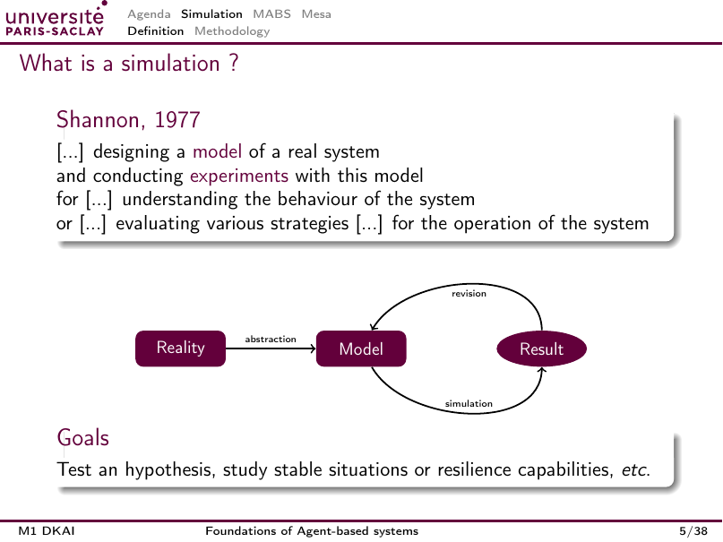
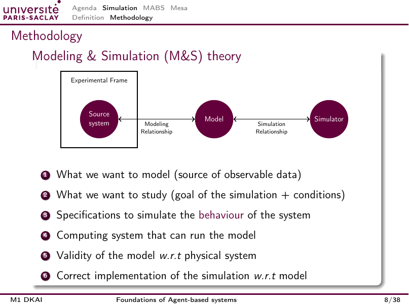
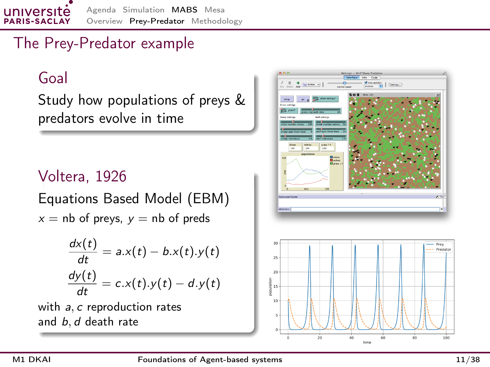
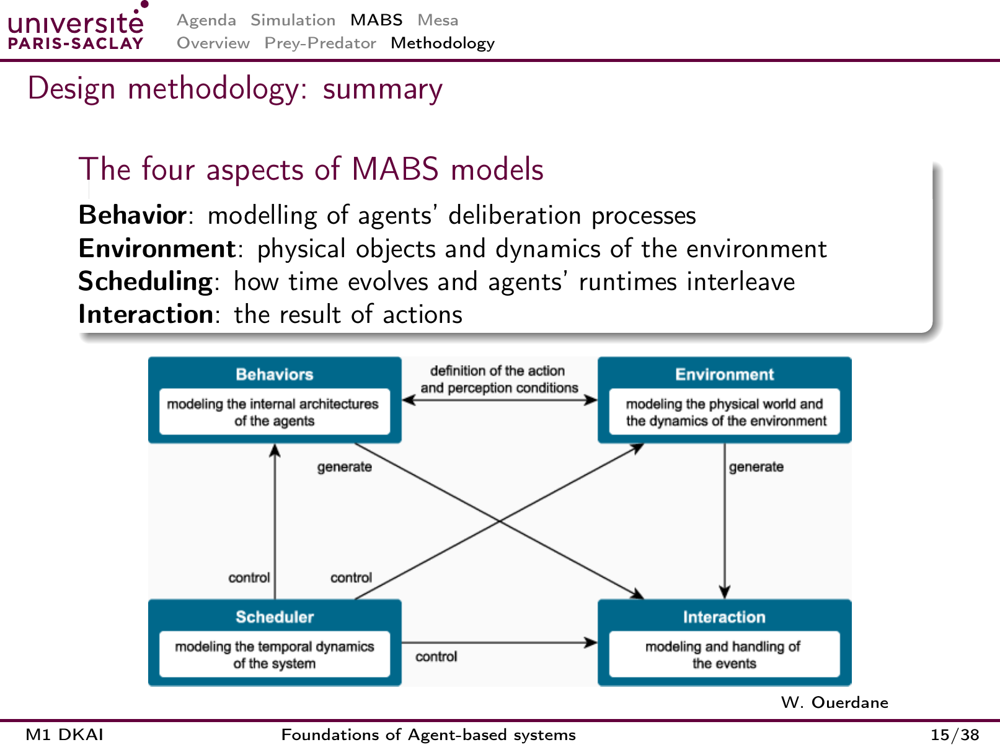
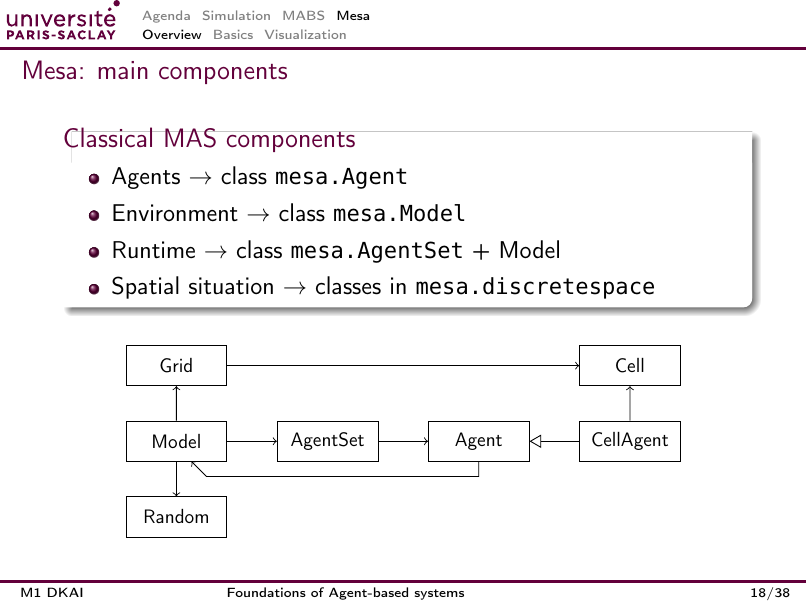
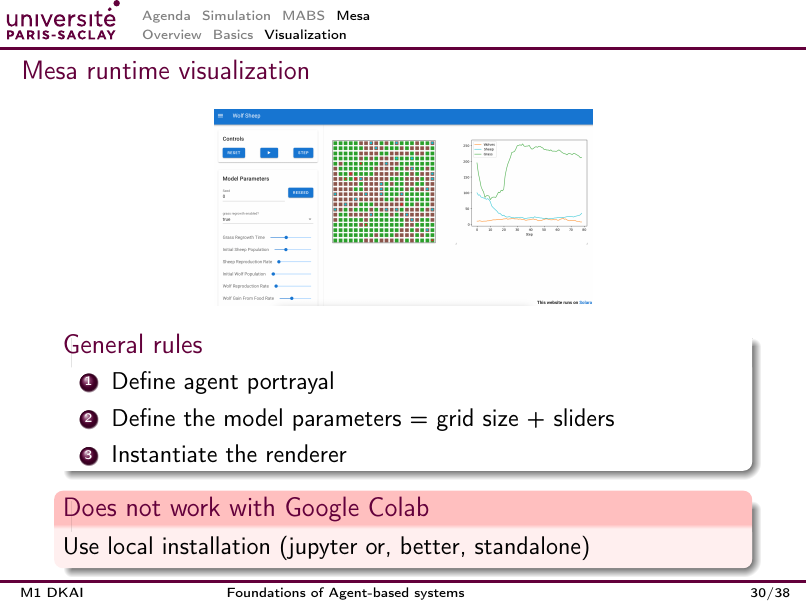

# Analyse visuelle des slides

Ce document distingue la session 4 ci-dessous et la session 5 ajoutée en fin de document. Les 10 pages de S5 ont été rendues et examinées le 19 octobre 2026.

**Statut : lecture visuelle du support fourni.** Les 47 pages ont été rendues et examinées, y compris les étapes d'animation. Les pages 18 et 23 disposent aussi d'un rendu détaillé à 320 dpi. Les [images de toutes les pages](slides/README.md) conservent les figures, annotations, légendes et captures.

Cette analyse décrit les relations visibles et leur sens pour la conception. Elle ne reconstruit pas des données numériques absentes du support. Certaines captures intégrées sont de faible résolution : agrandir une page n'ajoute pas les détails qui manquent déjà à l'image d'origine.

## Inventaire des visuels utiles

| Pages PDF | Diapo | Visuel examiné | Ce qu'il apporte |
| --- | --- | --- | --- |
| 1 | 1 | Capture NetLogo Wolf Sheep Predation | Association d'un espace, de paramètres et de courbes |
| 2 | 2 | Calendrier et flèche de séance courante | Progression du cours et distinction des séances MABS et Agentic AI |
| 5 | 5 | Réalité, modèle, résultat et boucle de révision | Le résultat expérimental sert à revoir la modélisation |
| 6 | 6 | Carte météorologique en couleurs | Illustration d'un phénomène dynamique et spatial |
| 7 et 8 | 7 | Système dynamique avec entrée, état et sortie | Distinction entre comportement observable et mécanisme interne |
| 9 à 15 | 8 | Construction progressive du cadre M&S | Deux relations différentes : validité du modèle et fidélité de son exécution |
| 16 | 9 | Simulation sur carte et interface de ménage | Possibilité de représenter des entités, activités et mesures à différentes échelles |
| 18 | 11 | Capture NetLogo et courbes proies-prédateurs | Décalage temporel entre populations et différence de niveaux d'observation |
| 23 | 15 | Diagramme à quatre blocs, attribué à W. Ouerdane | Liens entre comportement, environnement, ordonnancement et interaction |
| 25 et 38 | 17 et 30 | Interface Mesa Wolf Sheep | Paramètres à gauche, état spatial au centre, séries temporelles à droite |
| 26 | 18 | Schéma des composants Mesa | Relation entre modèle, agents, aléatoire et cellules |
| 30 à 33 | 22 à 25 | Texte coloré, croix et coche | Critiques du code et mise en évidence de la boucle recommandée |
| 37 et 38 | 29 et 30 | Encadrés de consignes | Environnement virtuel en local et contrainte de visualisation hors Colab |
| 39 à 46 | 31 à 37 | Exemples de code | Représentation d'agents, interface et composants de graphiques |

Les pages 3, 24, 36 et 47 sont principalement des transitions. Les autres pages principalement textuelles sont couvertes dans [le cours commenté](01_cours_complet.md). Les diapos 36 et 37 décrivent des courbes et histogrammes par du code, sans montrer leurs résultats graphiques.

## Réalité, modèle et résultat : diapo 5

La flèche « abstraction » part de la réalité vers le modèle. La flèche « simulation » va du modèle au résultat. La flèche « revision » revient du résultat au modèle.

**Sens pour la conception** : une expérience peut faire modifier une hypothèse ou une règle. Afficher une animation ne clôt pas le raisonnement. Il faut examiner ce que les résultats disent de la question étudiée et dans quelles conditions.

## Boîte noire : diapo 7

Le bloc central est un système dynamique avec état interne. À gauche se trouve l'entrée, à droite la sortie. Le comportement externe relie les deux autour du bloc. Les coches et croix distinguent la réaction observable des mécanismes internes inconnus.

**Sens pour la conception** : deux modèles différents peuvent reproduire des sorties similaires. La figure encourage à documenter les hypothèses sur les mécanismes internes et les limites de ce que l'expérience permet d'établir. Cette dernière conséquence est une interprétation du diagramme.

## Cadre M&S : diapo 8

Le cadre expérimental entoure le système source dans le dessin. Une liaison à deux extrémités relie le système source au modèle, sous l'étiquette « Modeling Relationship ». Une autre relie le modèle au simulateur, sous « Simulation Relationship ».

La première concerne la validité du modèle vis-à-vis du système réel. La seconde concerne la correction du simulateur vis-à-vis de la spécification. Les pages 9 à 15 construisent le même diagramme. Les lire comme sept modèles différents ferait perdre le sens de la révélation progressive.

**Sens pour la conception** : un code correct peut exécuter une hypothèse de modélisation inadéquate. Réciproquement, un modèle pertinent peut donner de mauvais résultats si le code n'applique pas ses règles.

## Courbes proies-prédateurs : diapo 11

Le graphique inférieur droit présente `time` en abscisse, de 0 à 100, et `population` en ordonnée, avec graduations jusqu'à 30. Il ne précise pas d'unité de temps, d'unité physique de population, de paramètres ou de graine.

La légende montre `Prey` en bleu continu et `Predator` en orange pointillé. Les deux populations oscillent. Les pics de proies précèdent ceux des prédateurs. Entre les pics, les populations deviennent très faibles. Le dessin n'établit pas leur extinction : être proche de zéro sur une courbe continue ne signifie pas qu'une population discrète a atteint exactement zéro.

La capture NetLogo au-dessus contient la grille, les paramètres d'herbe, de moutons et de loups, des compteurs et un autre graphique de populations. Cette capture est un exemple d'interface. Elle n'apporte pas les paramètres nécessaires pour reproduire avec certitude le graphique séparé placé en dessous.

**Interprétation** : l'augmentation des proies rend la croissance des prédateurs possible, puis la pression de prédation réduit les proies. Les interactions produisent une dynamique collective décalée. Pour le futur projet, cette figure suggère de suivre les mesures dans le temps et de relier une tendance globale aux mécanismes individuels. Elle ne garantit pas qu'un MABS quelconque produira des oscillations régulières.

## Les quatre aspects : diapo 15

Les quatre blocs et leurs descriptions internes sont :

| Bloc | Description de l'image, reformulée en français |
| --- | --- |
| Behaviors | Modélisation des architectures internes des agents |
| Environment | Modélisation du monde physique et de sa dynamique |
| Scheduler | Modélisation de la dynamique temporelle du système |
| Interaction | Modélisation et traitement des événements |

Les liens du schéma, souvent perdus dans l'extraction du texte, sont :

- Une liaison dans les deux sens entre comportements et environnement, portant la définition des conditions d'action et de perception.
- Une flèche des comportements vers les interactions, étiquetée « generate ».
- Une flèche de l'environnement vers les interactions, elle aussi étiquetée « generate ».
- Trois flèches depuis le scheduler vers les comportements, l'environnement et les interactions, chacune étiquetée « control ».

**Sens pour la conception** : l'ordre d'exécution fait partie du modèle. Il détermine quand les agents observent le monde, quand celui-ci évolue et quand les interactions produisent leurs effets. Changer l'ordonnancement peut modifier les résultats même si la règle individuelle reste identique.

## Composants Mesa : diapo 18

Le modèle est relié à la grille, à l'aléatoire et à l'ensemble des agents. `AgentSet` est relié aux agents. La grille mène aux cellules. `CellAgent` est relié à une cellule et hérite d'`Agent`, ce que représente le triangle creux. Un agent référence aussi son modèle.

**Sens pour la conception** : séparer l'entité active, sa localisation et les services communs. Les traits de ce dessin pédagogique ne précisent pas à eux seuls la propriété des objets ou tous les détails de l'API. Vérifier ceux-ci dans la documentation de la version retenue.

## Interface Wolf Sheep : diapos 17 et 30

La capture présente des commandes d'exécution et des paramètres à gauche, une grille au centre et un graphique à droite. La légende de la courbe distingue loups, moutons et herbe. Les courbes montrées ont des trajectoires différentes et ne ressemblent pas nécessairement aux oscillations idéales de la diapo 11.

La résolution de cette petite capture ne permet pas de relever avec fiabilité tous les chiffres et réglages. Aucun chiffre précis n'en a été déduit dans cette documentation.

**Sens pour la conception** : la grille aide à comprendre les interactions locales, les courbes montrent leur conséquence collective et les paramètres permettent d'explorer le modèle. Une visualisation devrait relier ces observations à la question du projet.

## Distribution des richesses : diapos 31, 36 et 37

Le cours définit un portrayal où `wealth > 0` produit un point bleu plus gros, autrement un point orange plus petit. Cette règle distingue les agents sans richesse de ceux qui en possèdent. Elle ne représente pas continûment le niveau de richesse parmi les agents positifs.

Le composant `Gini` suit une inégalité globale dans le temps. L'histogramme, défini avec dix classes dans la diapo 37, décrit la distribution instantanée des richesses. Ces représentations fournissent des informations différentes. Deux distributions peuvent avoir un indicateur global proche sans partager exactement la même forme.

**Proposition** : retenir seulement les représentations qui aident à expliquer l'hypothèse du futur projet et accompagner chaque graphique d'une définition des axes, des unités et des conditions de l'expérience.

## Session 5 : lecture visuelle du projet

Les [10 pages rendues](slides-session-5/README.md) et les trois planches conservent les couleurs, coches et croix du support. Il n'y a pas de résultat expérimental sur les taxis à extraire de ces images.

| Pages | Éléments visuels | Interprétation |
| --- | --- | --- |
| 1 à 3 | Couverture, calendrier avec flèche au 12 octobre, transition Mesa ou JADE | Contexte du projet ; le 19 octobre correspond à Agentic AI |
| 4 | Coches vertes pour l'organisation, croix rouges pour les interdictions, échéance en bas | Mesa ou JADE autorisés ; autres plateformes et MAS maison sans bibliothèque interdits |
| 5 | Livrables et cinq lignes à 20 % | Les cinq critères ont le même poids ; aucun résultat ou sous-barème masqué |
| 6 | Mission encadrée et progression numérotée introduite par un exemple | Incréments de partage suggérés, sans obligation explicite de tous les réaliser |
| 7 | Questions de modélisation ; mention « opt. » sur les deux dernières | Acceptabilité et embouteillages optionnels |
| 8 | Coches devant `MultiGrid`, communication minimale et visualisation ; croix devant la grille comme carte obligatoire | La croix ne prohibe pas la grille : elle accompagne la consigne de ne pas nécessairement en faire une carte détaillée |
| 9 | Croix devant le développement d'interface JADE, coches devant agents quartiers, temporisations et contrôle CPU | Consignes propres à JADE, distinctes de la visualisation demandée en Mesa |
| 10 | Invitation à commencer et pied de page `10/9` | Erreur de total dans le PDF, pas une page à ignorer |

L'examen visuel confirme le texte : CFP et réponses sont requis pour appeler un taxi. Le support ne fournit ni carte de ville imposée, ni tracé de résultats de taxis, ni valeurs numériques de simulation. Le [canevas](04_canevas_conception.md) contient donc des propositions explicites.
