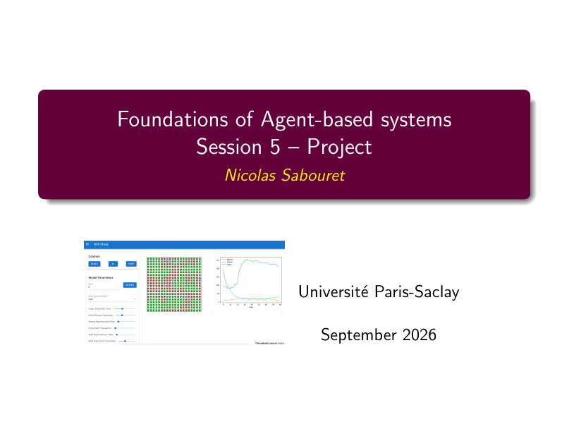
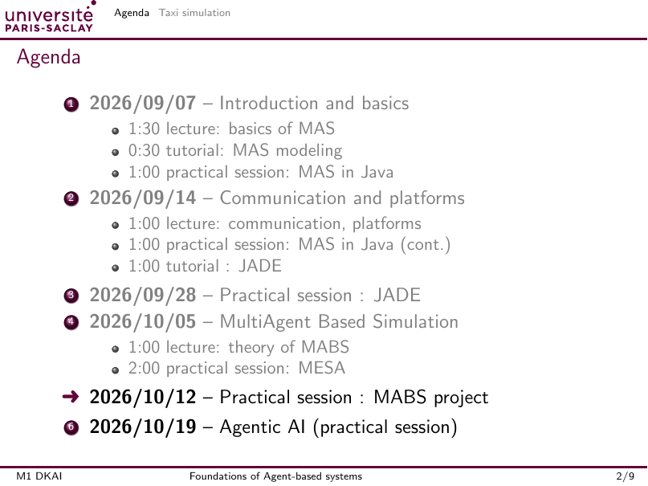
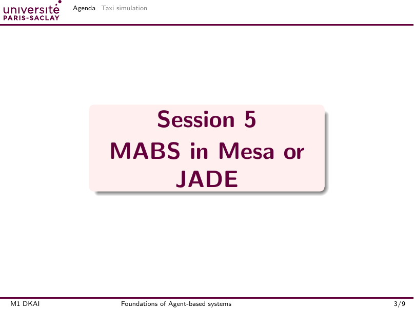
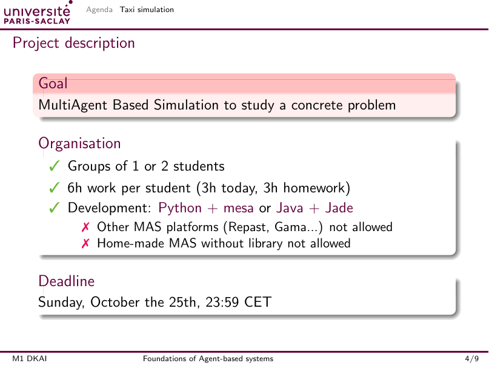
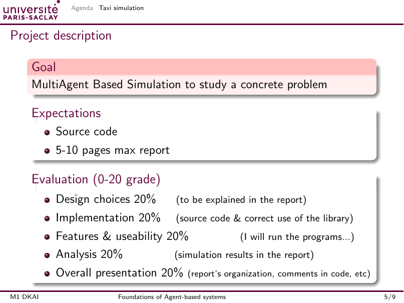
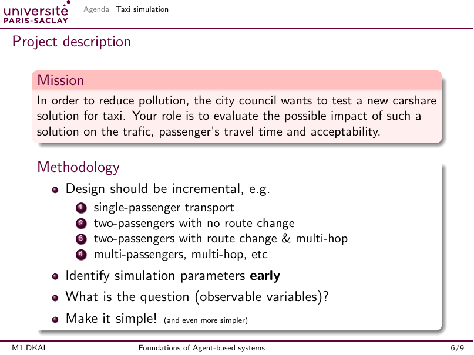
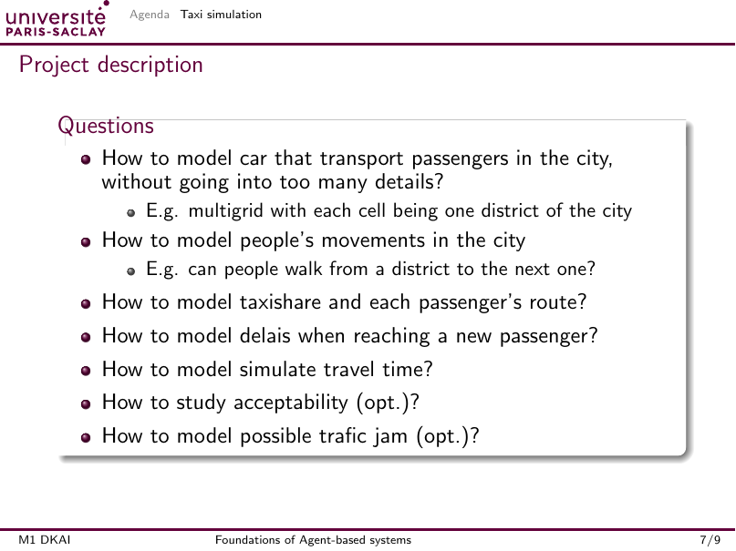
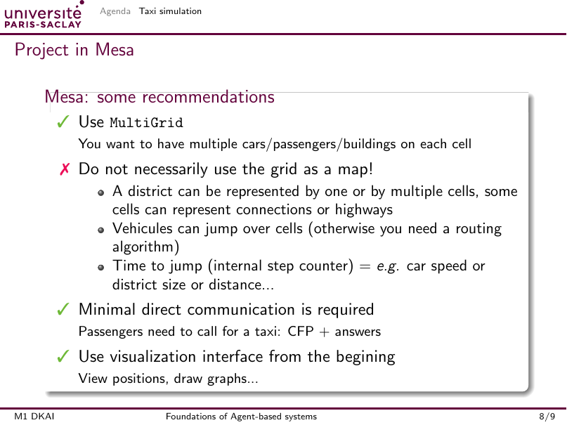
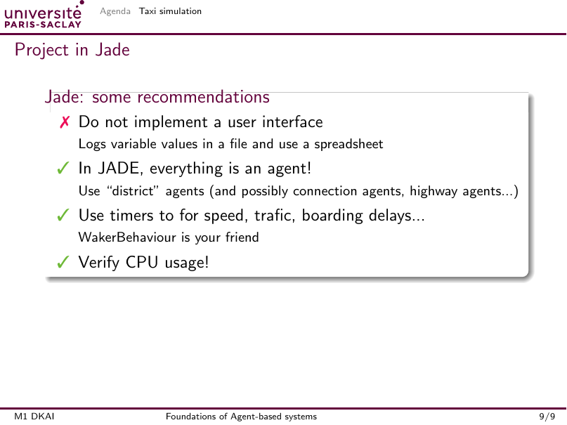
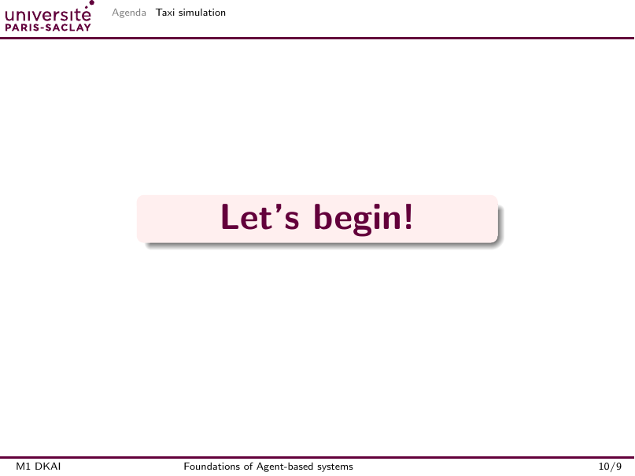

# Texte extrait du support

Source : `session-5.pdf`. La couche texte conserve les répétitions et peut perdre des espacements ou des formules. Les images sont consultables dans `pages/`. Chaque numéro désigne une page physique du PDF.

## Page 01



```text
Foundations of Agent-based systems
Session 5 – Project
Nicolas Sabouret
Universit´ e Paris-Saclay
September 2026
```

## Page 02



```text
Agenda Taxi simulation
Agenda
1 2026/09/07– Introduction and basics
1:30 lecture: basics of MAS
0:30 tutorial: MAS modeling
1:00 practical session: MAS in Java
2 2026/09/14– Communication and platforms
1:00 lecture: communication, platforms
1:00 practical session: MAS in Java (cont.)
1:00 tutorial : JADE
3 2026/09/28– Practical session : JADE
4 2026/10/05– MultiAgent Based Simulation
1:00 lecture: theory of MABS
2:00 practical session: MESA
➜2026/10/12– Practical session : MABS project
6 2026/10/19– Agentic AI (practical session)
M1 DKAI Foundations of Agent-based systems 2/9
```

## Page 03



```text
Agenda Taxi simulation
Session 5
MABS in Mesa or
JADE
M1 DKAI Foundations of Agent-based systems 3/9
```

## Page 04



```text
Agenda Taxi simulation
Project description
Goal
MultiAgent Based Simulation to study a concrete problem
Organisation
✓Groups of 1 or 2 students
✓6h work per student (3h today, 3h homework)
✓Development: Python + mesa or Java + Jade
✗Other MAS platforms (Repast, Gama...) not allowed
✗Home-made MAS without library not allowed
Deadline
Sunday, October the 25th, 23:59 CET
M1 DKAI Foundations of Agent-based systems 4/9
```

## Page 05



```text
Agenda Taxi simulation
Project description
Goal
MultiAgent Based Simulation to study a concrete problem
Expectations
Source code
5-10 pages max report
Evaluation (0-20 grade)
Design choices 20%(to be explained in the report)
Implementation 20%(source code & correct use of the library)
Features & useability 20%(I will run the programs...)
Analysis 20%(simulation results in the report)
Overall presentation 20%(report’s organization, comments in code, etc)
M1 DKAI Foundations of Agent-based systems 5/9
```

## Page 06



```text
Agenda Taxi simulation
Project description
Mission
In order to reduce pollution, the city council wants to test a new carshare
solution for taxi. Your role is to evaluate the possible impact of such a
solution on the trafic, passenger’s travel time and acceptability.
Methodology
Design should be incremental, e.g.
1 single-passenger transport
2 two-passengers with no route change
3 two-passengers with route change & multi-hop
4 multi-passengers, multi-hop, etc
Identify simulation parametersearly
What is the question (observable variables)?
Make it simple!(and even more simpler)
M1 DKAI Foundations of Agent-based systems 6/9
```

## Page 07



```text
Agenda Taxi simulation
Project description
Questions
How to model car that transport passengers in the city,
without going into too many details?
E.g. multigrid with each cell being one district of the city
How to model people’s movements in the city
E.g. can people walk from a district to the next one?
How to model taxishare and each passenger’s route?
How to model delais when reaching a new passenger?
How to model simulate travel time?
How to study acceptability (opt.)?
How to model possible trafic jam (opt.)?
M1 DKAI Foundations of Agent-based systems 7/9
```

## Page 08



```text
Agenda Taxi simulation
Project in Mesa
Mesa: some recommendations
✓UseMultiGrid
You want to have multiple cars/passengers/buildings on each cell
✗Do not necessarily use the grid as a map!
A district can be represented by one or by multiple cells, some
cells can represent connections or highways
Vehicules can jump over cells (otherwise you need a routing
algorithm)
Time to jump (internal step counter) =e.g.car speed or
district size or distance...
✓Minimal direct communication is required
Passengers need to call for a taxi: CFP + answers
✓Use visualization interface from the begining
View positions, draw graphs...
M1 DKAI Foundations of Agent-based systems 8/9
```

## Page 09



```text
Agenda Taxi simulation
Project in Jade
Jade: some recommendations
✗Do not implement a user interface
Logs variable values in a file and use a spreadsheet
✓In JADE, everything is an agent!
Use “district” agents (and possibly connection agents, highway agents...)
✓Use timers to for speed, trafic, boarding delays...
WakerBehaviour is your friend
✓Verify CPU usage!
M1 DKAI Foundations of Agent-based systems 9/9
```

## Page 10



```text
Agenda Taxi simulation
Let’s begin!
M1 DKAI Foundations of Agent-based systems 10/9
```
