# Texte extrait du support

Source : `session-4.pdf`. La couche texte conserve les répétitions et peut perdre des espacements ou des formules. Les images sont consultables dans `pages/`. Chaque numéro désigne une page physique du PDF.

## Page 01

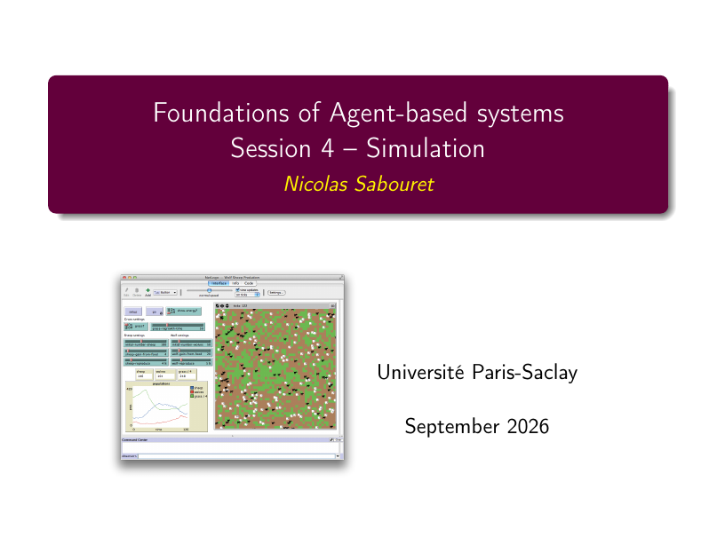

```text
Foundations of Agent-based systems
Session 4 – Simulation
Nicolas Sabouret
Université Paris-Saclay
September 2026
```

## Page 02

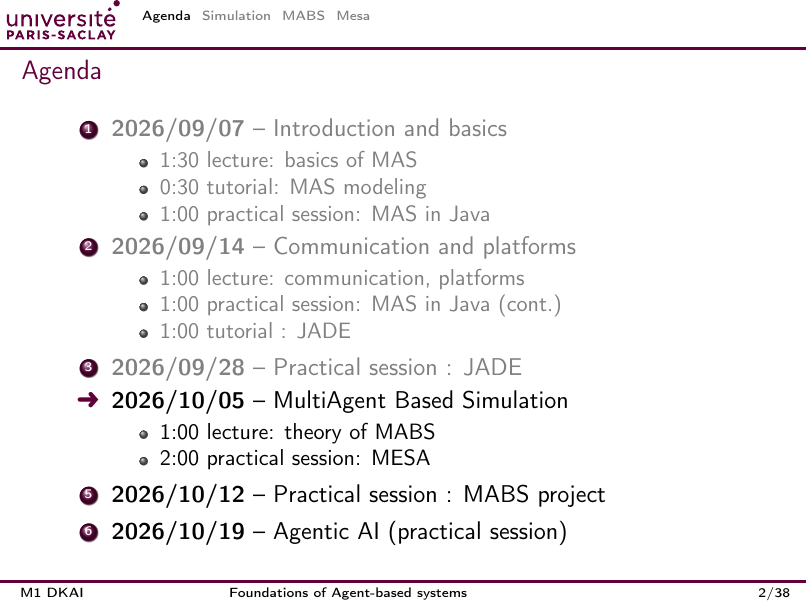

```text
Agenda Simulation MABS Mesa
Agenda
1 2026/09/07– Introduction and basics
1:30 lecture: basics of MAS
0:30 tutorial: MAS modeling
1:00 practical session: MAS in Java
2 2026/09/14– Communication and platforms
1:00 lecture: communication, platforms
1:00 practical session: MAS in Java (cont.)
1:00 tutorial : JADE
3 2026/09/28– Practical session : JADE
➜2026/10/05– MultiAgent Based Simulation
1:00 lecture: theory of MABS
2:00 practical session: MESA
5 2026/10/12– Practical session : MABS project
6 2026/10/19– Agentic AI (practical session)
M1 DKAI Foundations of Agent-based systems 2/38
```

## Page 03

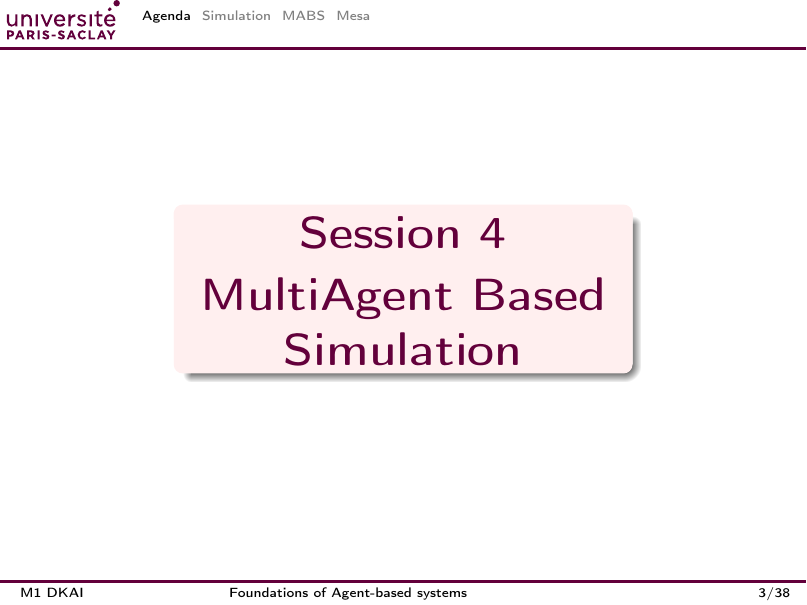

```text
Agenda Simulation MABS Mesa
Session 4
MultiAgent Based
Simulation
M1 DKAI Foundations of Agent-based systems 3/38
```

## Page 04

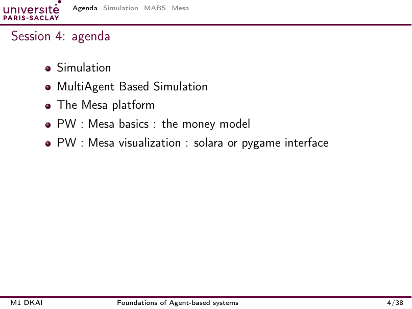

```text
Agenda Simulation MABS Mesa
Session 4: agenda
Simulation
MultiAgent Based Simulation
The Mesa platform
PW : Mesa basics : the money model
PW : Mesa visualization : solara or pygame interface
M1 DKAI Foundations of Agent-based systems 4/38
```

## Page 05


```text
Agenda Simulation MABS Mesa
Definition Methodology
What is a simulation ?
Shannon, 1977
[...] designing a model of a real system
and conducting experiments with this model
for [...] understanding the behaviour of the system
or [...] evaluating various strategies [...] for the operation of the system
Reality Model
abstraction
Result
revision
simulation
Goals
Test an hypothesis, study stable situations or resilience capabilities,etc.
M1 DKAI Foundations of Agent-based systems 5/38
```

## Page 06

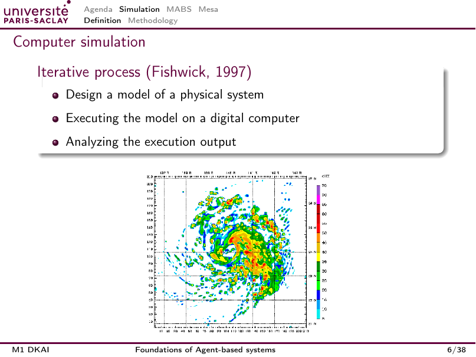

```text
Agenda Simulation MABS Mesa
Definition Methodology
Computer simulation
Iterative process (Fishwick, 1997)
Design a model of a physical system
Executing the model on a digital computer
Analyzing the execution output
M1 DKAI Foundations of Agent-based systems 6/38
```

## Page 07

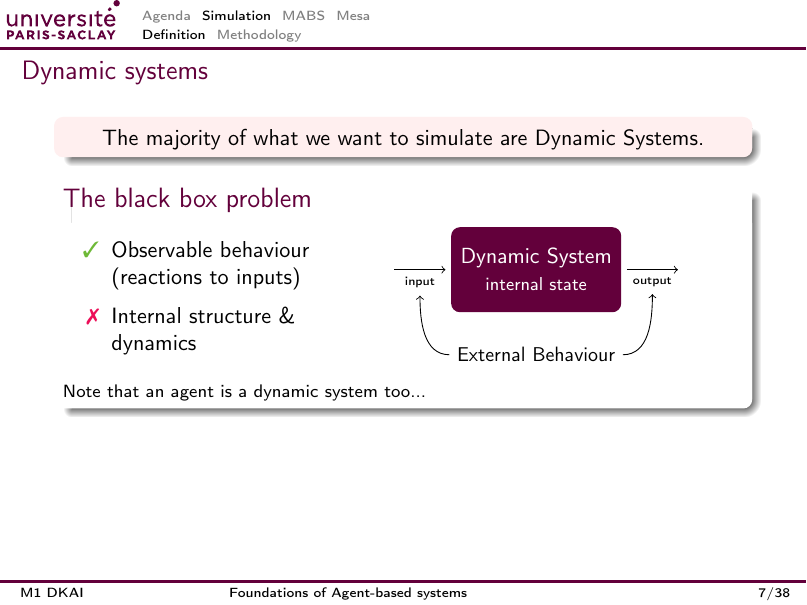

```text
Agenda Simulation MABS Mesa
Definition Methodology
Dynamic systems
The majority of what we want to simulate are Dynamic Systems.
The black box problem
✓Observable behaviour
(reactions to inputs)
✗Internal structure &
dynamics
Dynamic System
internal stateinput output
External Behaviour
Note that an agent is a dynamic system too...
Problem
✓Computer Simulation→Formal Specifications
✗Lack of knowledge about the system’s internal
✗Choice of formalism constraints the observations
M1 DKAI Foundations of Agent-based systems 7/38
```

## Page 08

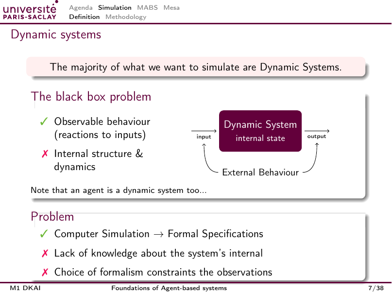

```text
Agenda Simulation MABS Mesa
Definition Methodology
Dynamic systems
The majority of what we want to simulate are Dynamic Systems.
The black box problem
✓Observable behaviour
(reactions to inputs)
✗Internal structure &
dynamics
Dynamic System
internal stateinput output
External Behaviour
Note that an agent is a dynamic system too...
Problem
✓Computer Simulation→Formal Specifications
✗Lack of knowledge about the system’s internal
✗Choice of formalism constraints the observations
M1 DKAI Foundations of Agent-based systems 7/38
```

## Page 09

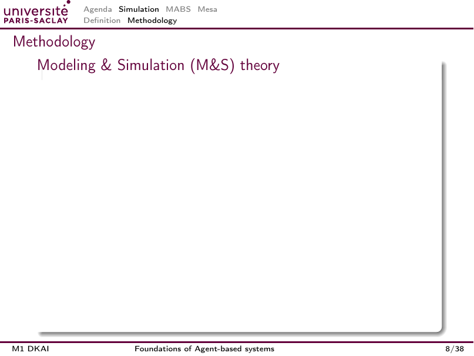

```text
Agenda Simulation MABS Mesa
Definition Methodology
Methodology
Modeling & Simulation (M&S) theory
Sourcesystem
Experimental Frame
Model SimulatorModelingRelationship SimulationRelationship
1 What we want to model (source of observable data)
2 What we want to study (goal of the simulation + conditions)
3 Specifications to simulate the behaviour of the system
4 Computing system that can run the model
5 Validity of the modelw.r.tphysical system
6 Correct implementation of the simulationw.r.tmodel
M1 DKAI Foundations of Agent-based systems 8/38
```

## Page 10

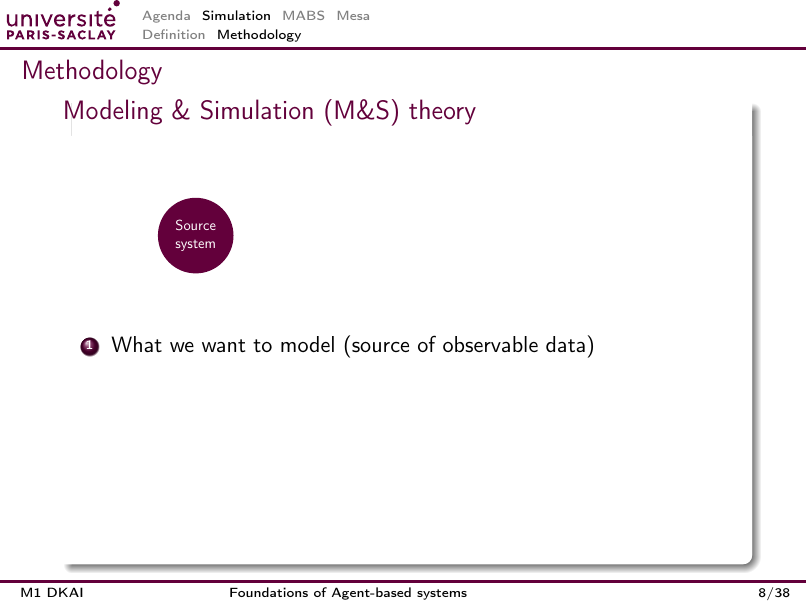

```text
Agenda Simulation MABS Mesa
Definition Methodology
Methodology
Modeling & Simulation (M&S) theory
Sourcesystem
Experimental Frame
Model SimulatorModelingRelationship SimulationRelationship
1 What we want to model (source of observable data)
2 What we want to study (goal of the simulation + conditions)
3 Specifications to simulate the behaviour of the system
4 Computing system that can run the model
5 Validity of the modelw.r.tphysical system
6 Correct implementation of the simulationw.r.tmodel
M1 DKAI Foundations of Agent-based systems 8/38
```

## Page 11

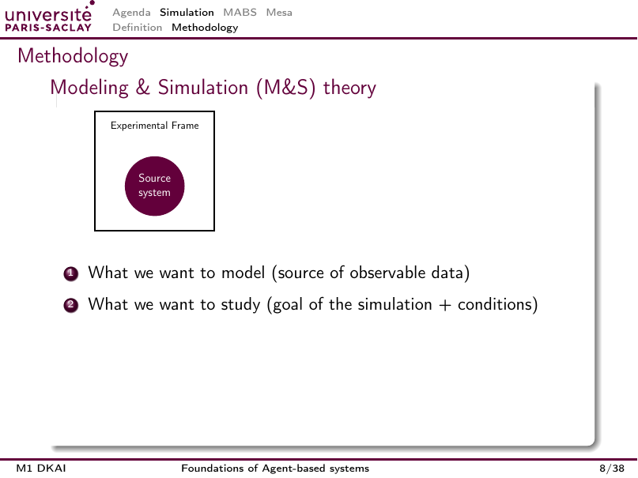

```text
Agenda Simulation MABS Mesa
Definition Methodology
Methodology
Modeling & Simulation (M&S) theory
Sourcesystem
Experimental Frame
Model SimulatorModelingRelationship SimulationRelationship
1 What we want to model (source of observable data)
2 What we want to study (goal of the simulation + conditions)
3 Specifications to simulate the behaviour of the system
4 Computing system that can run the model
5 Validity of the modelw.r.tphysical system
6 Correct implementation of the simulationw.r.tmodel
M1 DKAI Foundations of Agent-based systems 8/38
```

## Page 12

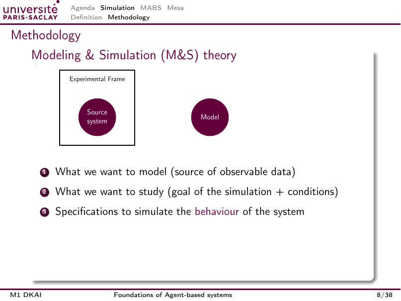

```text
Agenda Simulation MABS Mesa
Definition Methodology
Methodology
Modeling & Simulation (M&S) theory
Sourcesystem
Experimental Frame
Model
SimulatorModelingRelationship SimulationRelationship
1 What we want to model (source of observable data)
2 What we want to study (goal of the simulation + conditions)
3 Specifications to simulate the behaviour of the system
4 Computing system that can run the model
5 Validity of the modelw.r.tphysical system
6 Correct implementation of the simulationw.r.tmodel
M1 DKAI Foundations of Agent-based systems 8/38
```

## Page 13

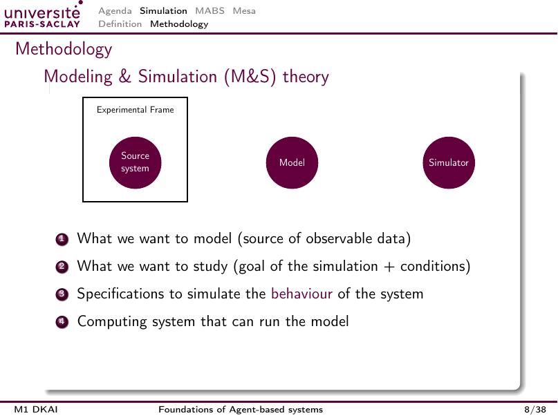

```text
Agenda Simulation MABS Mesa
Definition Methodology
Methodology
Modeling & Simulation (M&S) theory
Sourcesystem
Experimental Frame
Model Simulator
ModelingRelationship SimulationRelationship
1 What we want to model (source of observable data)
2 What we want to study (goal of the simulation + conditions)
3 Specifications to simulate the behaviour of the system
4 Computing system that can run the model
5 Validity of the modelw.r.tphysical system
6 Correct implementation of the simulationw.r.tmodel
M1 DKAI Foundations of Agent-based systems 8/38
```

## Page 14

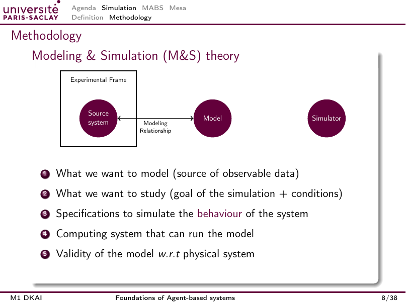

```text
Agenda Simulation MABS Mesa
Definition Methodology
Methodology
Modeling & Simulation (M&S) theory
Sourcesystem
Experimental Frame
Model SimulatorModelingRelationship
SimulationRelationship
1 What we want to model (source of observable data)
2 What we want to study (goal of the simulation + conditions)
3 Specifications to simulate the behaviour of the system
4 Computing system that can run the model
5 Validity of the modelw.r.tphysical system
6 Correct implementation of the simulationw.r.tmodel
M1 DKAI Foundations of Agent-based systems 8/38
```

## Page 15


```text
Agenda Simulation MABS Mesa
Definition Methodology
Methodology
Modeling & Simulation (M&S) theory
Sourcesystem
Experimental Frame
Model SimulatorModelingRelationship SimulationRelationship
1 What we want to model (source of observable data)
2 What we want to study (goal of the simulation + conditions)
3 Specifications to simulate the behaviour of the system
4 Computing system that can run the model
5 Validity of the modelw.r.tphysical system
6 Correct implementation of the simulationw.r.tmodel
M1 DKAI Foundations of Agent-based systems 8/38
```

## Page 16

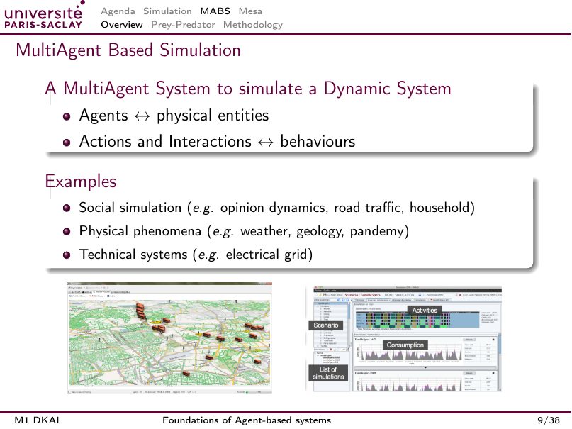

```text
Agenda Simulation MABS Mesa
Overview Prey-Predator Methodology
MultiAgent Based Simulation
A MultiAgent System to simulate a Dynamic System
Agents↔physical entities
Actions and Interactions↔behaviours
Examples
Social simulation (e.g.opinion dynamics, road traffic, household)
Physical phenomena (e.g.weather, geology, pandemy)
Technical systems (e.g.electrical grid)
M1 DKAI Foundations of Agent-based systems 9/38
```

## Page 17

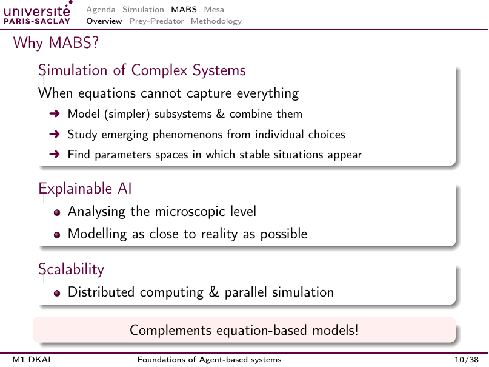

```text
Agenda Simulation MABS Mesa
Overview Prey-Predator Methodology
Why MABS?
Simulation of Complex Systems
When equations cannot capture everything
➜Model (simpler) subsystems & combine them
➜Study emerging phenomenons from individual choices
➜Find parameters spaces in which stable situations appear
Explainable AI
Analysing the microscopic level
Modelling as close to reality as possible
Scalability
Distributed computing & parallel simulation
Complements equation-based models!
M1 DKAI Foundations of Agent-based systems 10/38
```

## Page 18

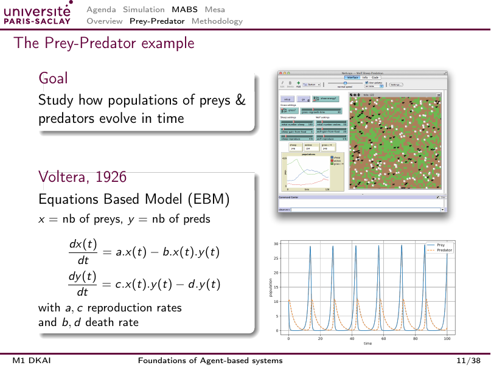

```text
Agenda Simulation MABS Mesa
Overview Prey-Predator Methodology
The Prey-Predator example
Goal
Study how populations of preys &
predators evolve in time
Voltera, 1926
Equations Based Model (EBM)
x=nb of preys,y=nb of preds
dx(t)
dt =a.x(t)−b.x(t).y(t)
dy(t)
dt =c.x(t).y(t)−d.y(t)
witha,creproduction rates
andb,ddeath rate
M1 DKAI Foundations of Agent-based systems 11/38
```

## Page 19

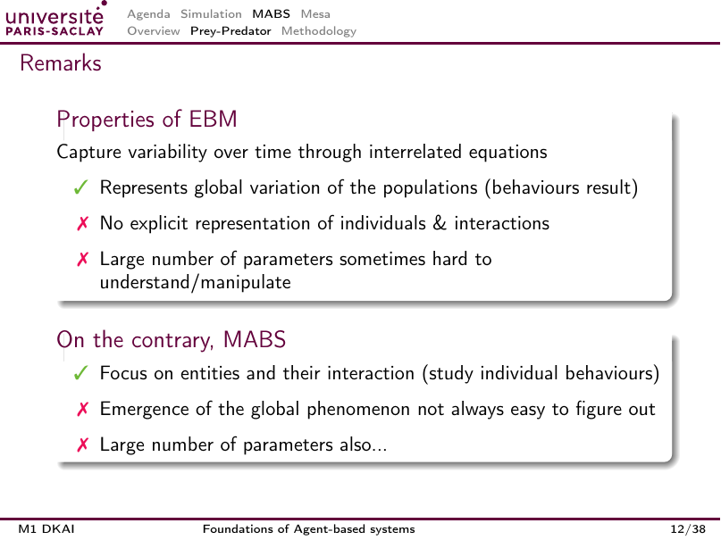

```text
Agenda Simulation MABS Mesa
Overview Prey-Predator Methodology
Remarks
Properties of EBM
Capture variability over time through interrelated equations
✓Represents global variation of the populations (behaviours result)
✗No explicit representation of individuals & interactions
✗Large number of parameters sometimes hard to
understand/manipulate
On the contrary, MABS
✓Focus on entities and their interaction (study individual behaviours)
✗Emergence of the global phenomenon not always easy to figure out
✗Large number of parameters also...
M1 DKAI Foundations of Agent-based systems 12/38
```

## Page 20

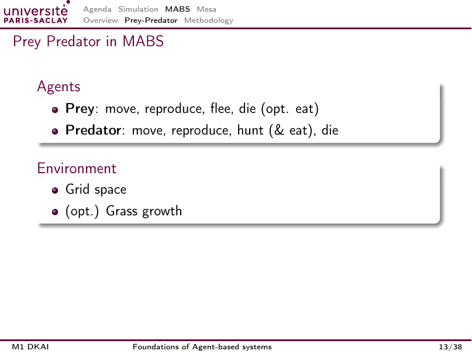

```text
Agenda Simulation MABS Mesa
Overview Prey-Predator Methodology
Prey Predator in MABS
Agents
Prey: move, reproduce, flee, die (opt. eat)
Predator: move, reproduce, hunt (& eat), die
Environment
Grid space
(opt.) Grass growth
Difficulty
Find the parameter values that reproduces the global phenomenon
(a.k.a. stylised fact)
M1 DKAI Foundations of Agent-based systems 13/38
```

## Page 21

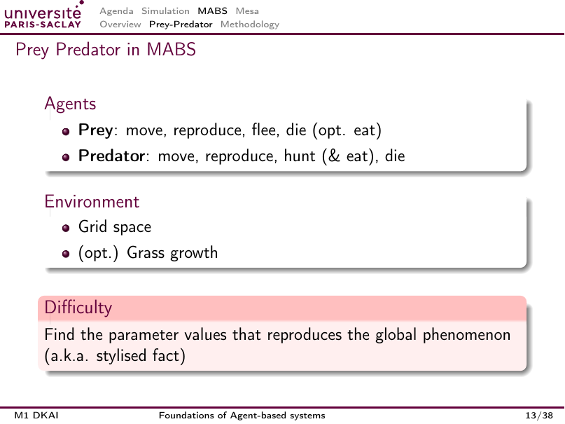

```text
Agenda Simulation MABS Mesa
Overview Prey-Predator Methodology
Prey Predator in MABS
Agents
Prey: move, reproduce, flee, die (opt. eat)
Predator: move, reproduce, hunt (& eat), die
Environment
Grid space
(opt.) Grass growth
Difficulty
Find the parameter values that reproduces the global phenomenon
(a.k.a. stylised fact)
M1 DKAI Foundations of Agent-based systems 13/38
```

## Page 22

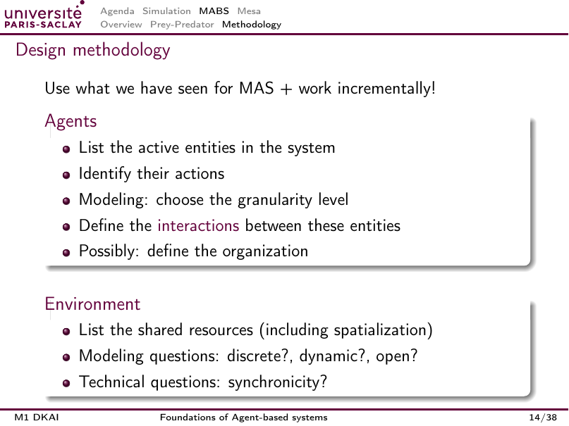

```text
Agenda Simulation MABS Mesa
Overview Prey-Predator Methodology
Design methodology
Use what we have seen for MAS + work incrementally!
Agents
List the active entities in the system
Identify their actions
Modeling: choose the granularity level
Define the interactions between these entities
Possibly: define the organization
Environment
List the shared resources (including spatialization)
Modeling questions: discrete?, dynamic?, open?
Technical questions: synchronicity?
M1 DKAI Foundations of Agent-based systems 14/38
```

## Page 23

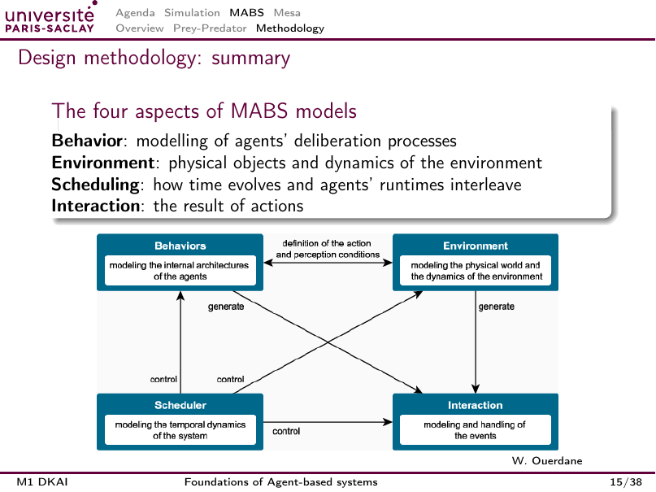

```text
Agenda Simulation MABS Mesa
Overview Prey-Predator Methodology
Design methodology: summary
The four aspects of MABS models
Behavior: modelling of agents’ deliberation processes
Environment: physical objects and dynamics of the environment
Scheduling: how time evolves and agents’ runtimes interleave
Interaction: the result of actions
W. Ouerdane
M1 DKAI Foundations of Agent-based systems 15/38
```

## Page 24

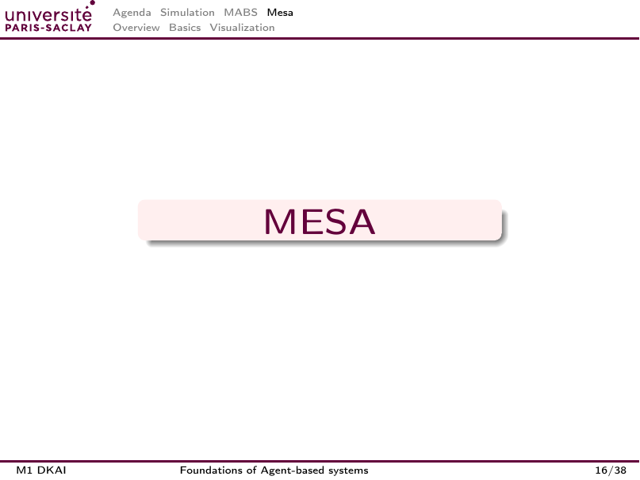

```text
Agenda Simulation MABS Mesa
Overview Basics Visualization
MESA
M1 DKAI Foundations of Agent-based systems 16/38
```

## Page 25

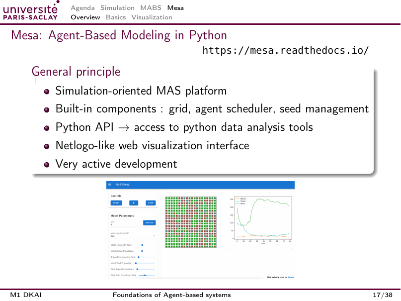

```text
Agenda Simulation MABS Mesa
Overview Basics Visualization
Mesa: Agent-Based Modeling in Python
https://mesa.readthedocs.io/
General principle
Simulation-oriented MAS platform
Built-in components : grid, agent scheduler, seed management
Python API→access to python data analysis tools
Netlogo-like web visualization interface
Very active development
M1 DKAI Foundations of Agent-based systems 17/38
```

## Page 26


```text
Agenda Simulation MABS Mesa
Overview Basics Visualization
Mesa: main components
Classical MAS components
Agents→classmesa.Agent
Environment→classmesa.Model
Runtime→classmesa.AgentSet+ Model
Spatial situation→classes inmesa.discretespace
Model
Grid
Random
AgentSet Agent
Cell
CellAgent
M1 DKAI Foundations of Agent-based systems 18/38
```

## Page 27

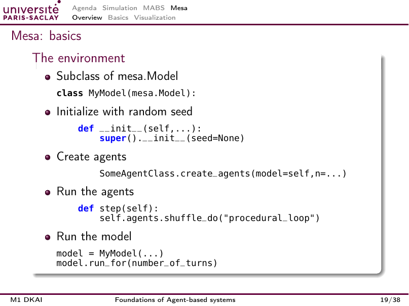

```text
Agenda Simulation MABS Mesa
Overview Basics Visualization
Mesa: basics
The environment
Subclass of mesa.Model
classMyModel(mesa.Model):
Initialize with random seed
def __init__(self,...):
super().__init__(seed=None)
Create agents
SomeAgentClass.create_agents(model=self,n=...)
Run the agents
defstep(self):
self.agents.shuffle_do("procedural_loop")
Run the model
model = MyModel(...)
model.run_for(number_of_turns)
M1 DKAI Foundations of Agent-based systems 19/38
```

## Page 28

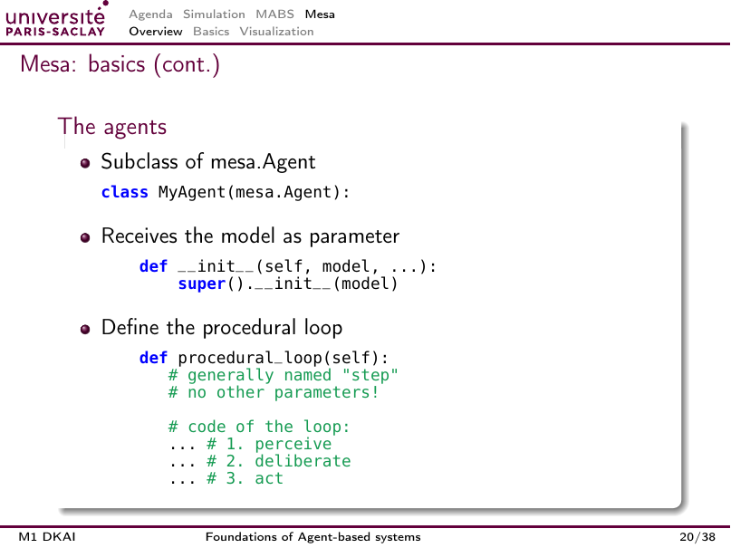

```text
Agenda Simulation MABS Mesa
Overview Basics Visualization
Mesa: basics (cont.)
The agents
Subclass of mesa.Agent
classMyAgent(mesa.Agent):
Receives the model as parameter
def __init__(self, model, ...):
super().__init__(model)
Define the procedural loop
defprocedural _loop(self):
# generally named "step"
# no other parameters!
# code of the loop:
... # 1. perceive
... # 2. deliberate
... # 3. act
M1 DKAI Foundations of Agent-based systems 20/38
```

## Page 29

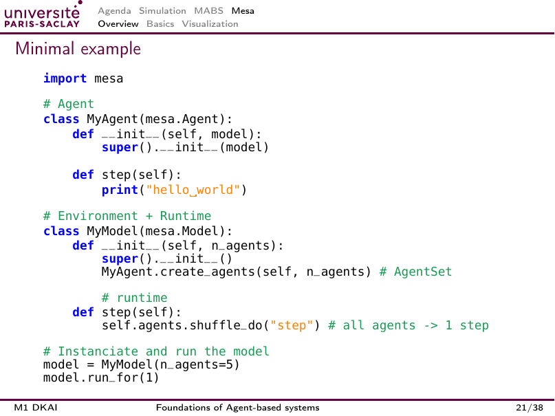

```text
Agenda Simulation MABS Mesa
Overview Basics Visualization
Minimal example
importmesa
# Agent
classMyAgent(mesa.Agent):
def __init__(self, model):
super().__init__(model)
defstep(self):
print("hello world")
# Environment + Runtime
classMyModel(mesa.Model):
def __init__(self, n _agents):
super().__init__()
MyAgent.create_agents(self, n _agents) # AgentSet
# runtime
defstep(self):
self.agents.shuffle_do("step") # all agents -> 1 step
# Instanciate and run the model
model = MyModel(n _agents=5)
model.run_for(1)
M1 DKAI Foundations of Agent-based systems 21/38
```

## Page 30

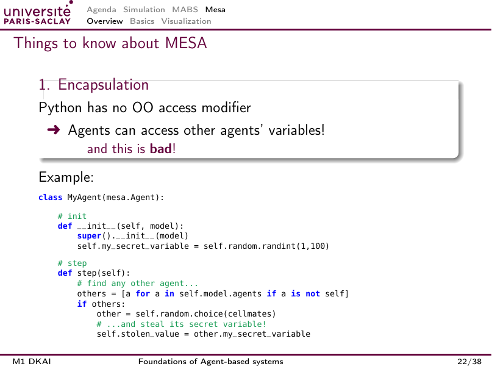

```text
Agenda Simulation MABS Mesa
Overview Basics Visualization
Things to know about MESA
1. Encapsulation
Python has no OO access modifier
➜Agents can access other agents’ variables!
and this isbad!
Example:
classMyAgent(mesa.Agent):
# init
def __init__(self, model):
super().__init__(model)
self.my_secret_variable = self.random.randint(1,100)
# step
defstep(self):
# find any other agent...
others = [aforainself.model.agentsifais notself]
ifothers:
other = self.random.choice(cellmates)
# ...and steal its secret variable!
self.stolen_value = other.my _secret_variable
M1 DKAI Foundations of Agent-based systems 22/38
```

## Page 31

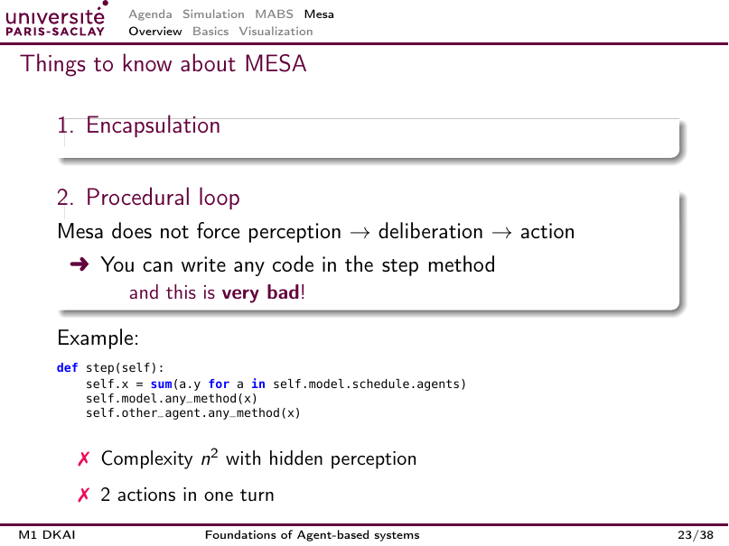

```text
Agenda Simulation MABS Mesa
Overview Basics Visualization
Things to know about MESA
1. Encapsulation
2. Procedural loop
Mesa does not force perception→deliberation→action
➜You can write any code in the step method
and this isvery bad!
Example:
defstep(self):
self.x =sum(a.yforainself.model.schedule.agents)
self.model.any_method(x)
self.other_agent.any_method(x)
✗Complexityn 2 with hidden perception
✗2 actions in one turn
M1 DKAI Foundations of Agent-based systems 23/38
```

## Page 32

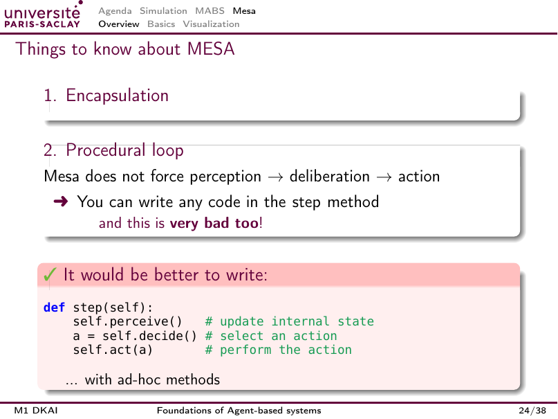

```text
Agenda Simulation MABS Mesa
Overview Basics Visualization
Things to know about MESA
1. Encapsulation
2. Procedural loop
Mesa does not force perception→deliberation→action
➜You can write any code in the step method
and this isvery bad too!
✓It would be better to write:
defstep(self):
self.perceive() # update internal state
a = self.decide() # select an action
self.act(a) # perform the action
... with ad-hoc methods
M1 DKAI Foundations of Agent-based systems 24/38
```

## Page 33

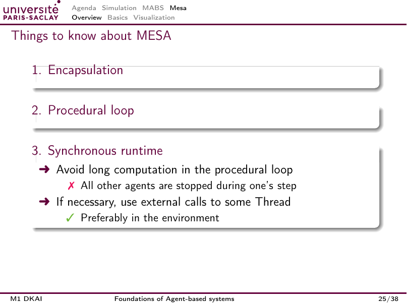

```text
Agenda Simulation MABS Mesa
Overview Basics Visualization
Things to know about MESA
1. Encapsulation
2. Procedural loop
3. Synchronous runtime
➜Avoid long computation in the procedural loop
✗All other agents are stopped during one’s step
➜If necessary, use external calls to some Thread
✓Preferably in the environment
M1 DKAI Foundations of Agent-based systems 25/38
```

## Page 34

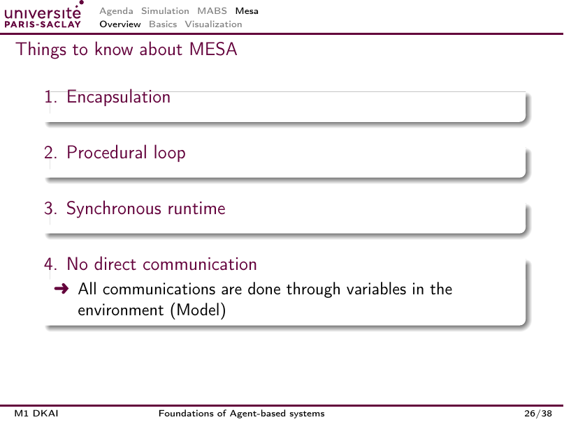

```text
Agenda Simulation MABS Mesa
Overview Basics Visualization
Things to know about MESA
1. Encapsulation
2. Procedural loop
3. Synchronous runtime
4. No direct communication
➜All communications are done through variables in the
environment (Model)
M1 DKAI Foundations of Agent-based systems 26/38
```

## Page 35

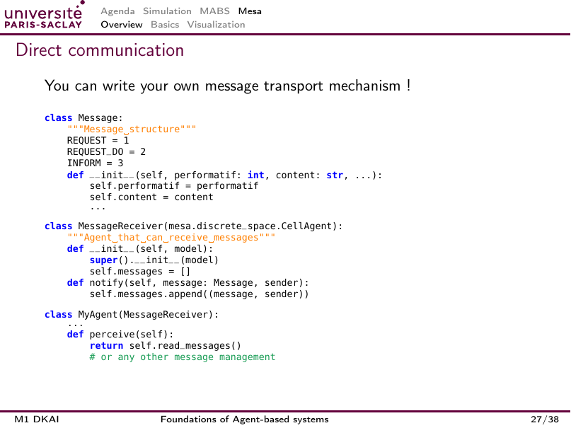

```text
Agenda Simulation MABS Mesa
Overview Basics Visualization
Direct communication
You can write your own message transport mechanism !
classMessage:
"""Message structure"""
REQUEST = 1
REQUEST_DO = 2
INFORM = 3
def __init__(self, performatif:int, content:str, ...):
self.performatif = performatif
self.content = content
...
classMessageReceiver(mesa.discrete _space.CellAgent):
"""Agent that can receive messages"""
def __init__(self, model):
super().__init__(model)
self.messages = []
defnotify(self, message: Message, sender):
self.messages.append((message, sender))
classMyAgent(MessageReceiver):
...
defperceive(self):
returnself.read _messages()
# or any other message management
M1 DKAI Foundations of Agent-based systems 27/38
```

## Page 36

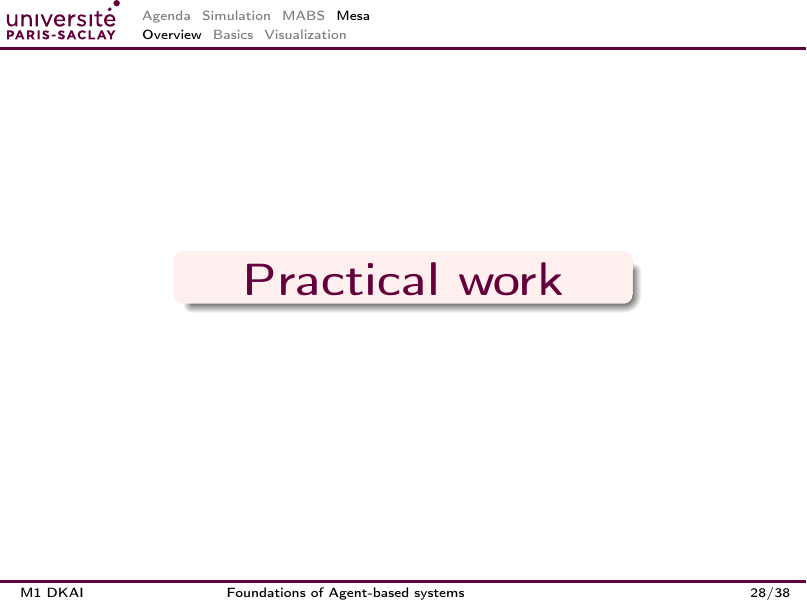

```text
Agenda Simulation MABS Mesa
Overview Basics Visualization
Practical work
M1 DKAI Foundations of Agent-based systems 28/38
```

## Page 37

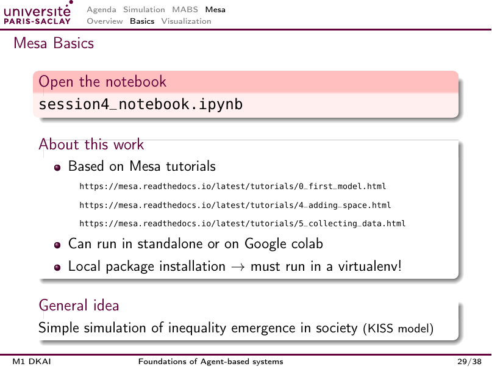

```text
Agenda Simulation MABS Mesa
Overview Basics Visualization
Mesa Basics
Open the notebook
session4_notebook.ipynb
About this work
Based on Mesa tutorials
https://mesa.readthedocs.io/latest/tutorials/0_first_model.html
https://mesa.readthedocs.io/latest/tutorials/4_adding_space.html
https://mesa.readthedocs.io/latest/tutorials/5_collecting_data.html
Can run in standalone or on Google colab
Local package installation→must run in a virtualenv!
General idea
Simple simulation of inequality emergence in society(KISS model)
M1 DKAI Foundations of Agent-based systems 29/38
```

## Page 38


```text
Agenda Simulation MABS Mesa
Overview Basics Visualization
Mesa runtime visualization
General rules
1 Define agent portrayal
2 Define the model parameters = grid size + sliders
3 Instantiate the renderer
Does not work with Google Colab
Use local installation (jupyter or, better, standalone)
M1 DKAI Foundations of Agent-based systems 30/38
```

## Page 39

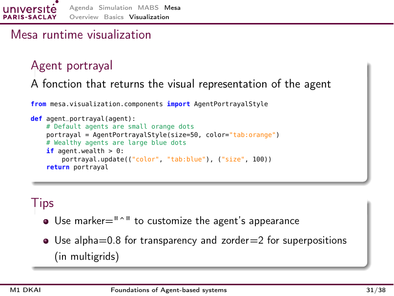

```text
Agenda Simulation MABS Mesa
Overview Basics Visualization
Mesa runtime visualization
Agent portrayal
A fonction that returns the visual representation of the agent
frommesa.visualization.componentsimportAgentPortrayalStyle
defagent _portrayal(agent):
# Default agents are small orange dots
portrayal = AgentPortrayalStyle(size=50, color="tab:orange")
# Wealthy agents are large blue dots
ifagent.wealth > 0:
portrayal.update(("color", "tab:blue"), ("size", 100))
returnportrayal
Tips
Use marker="^" to customize the agent’s appearance
Use alpha=0.8 for transparency and zorder=2 for superpositions
(in multigrids)
M1 DKAI Foundations of Agent-based systems 31/38
```

## Page 40

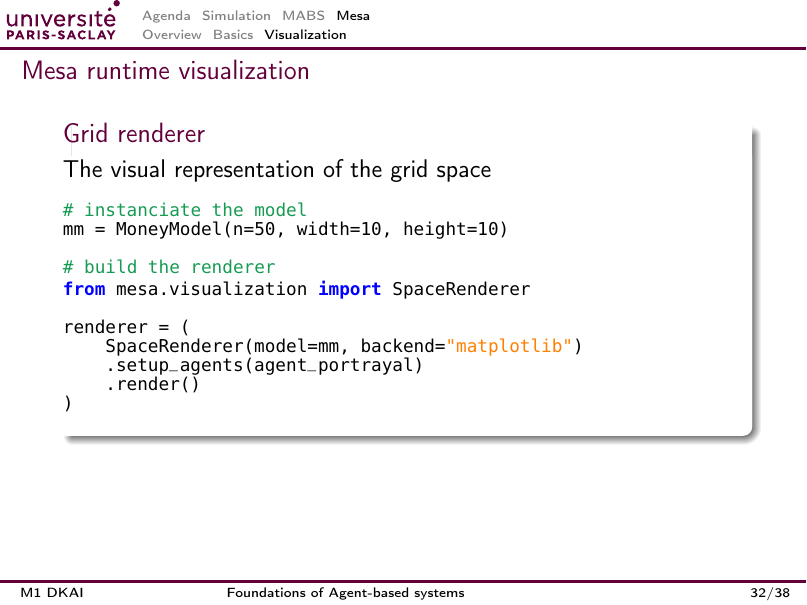

```text
Agenda Simulation MABS Mesa
Overview Basics Visualization
Mesa runtime visualization
Grid renderer
The visual representation of the grid space
# instanciate the model
mm = MoneyModel(n=50, width=10, height=10)
# build the renderer
frommesa.visualizationimportSpaceRenderer
renderer = (
SpaceRenderer(model=mm, backend="matplotlib")
.setup_agents(agent_portrayal)
.render()
)
M1 DKAI Foundations of Agent-based systems 32/38
```

## Page 41

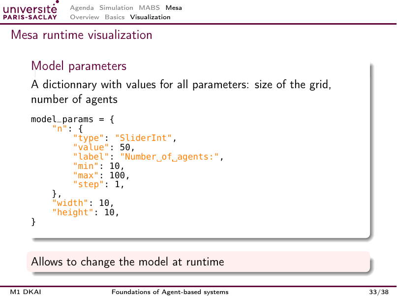

```text
Agenda Simulation MABS Mesa
Overview Basics Visualization
Mesa runtime visualization
Model parameters
A dictionnary with values for all parameters: size of the grid,
number of agents
model_params = {
"n": {
"type": "SliderInt",
"value": 50,
"label": "Number of agents:",
"min": 10,
"max": 100,
"step": 1,
},
"width": 10,
"height": 10,
}
Allows to change the model at runtime
M1 DKAI Foundations of Agent-based systems 33/38
```

## Page 42

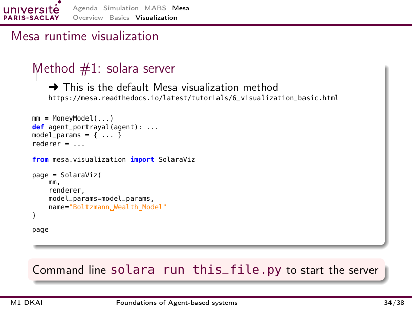

```text
Agenda Simulation MABS Mesa
Overview Basics Visualization
Mesa runtime visualization
Method #1: solara server
➜This is the default Mesa visualization method
https://mesa.readthedocs.io/latest/tutorials/6_visualization_basic.html
mm = MoneyModel(...)
defagent _portrayal(agent): ...
model_params = { ... }
rederer = ...
frommesa.visualizationimportSolaraViz
page = SolaraViz(
mm,
renderer,
model_params=model_params,
name="Boltzmann Wealth Model"
)
page
Command linesolara run this _file.pyto start the server
M1 DKAI Foundations of Agent-based systems 34/38
```

## Page 43

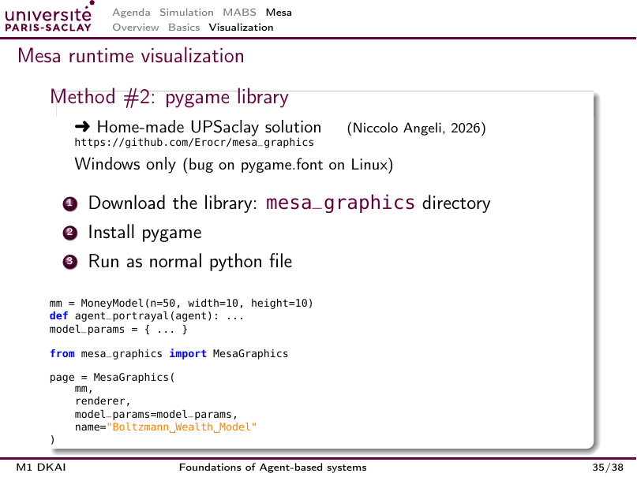

```text
Agenda Simulation MABS Mesa
Overview Basics Visualization
Mesa runtime visualization
Method #2: pygame library
➜Home-made UPSaclay solution(Niccolo Angeli, 2026)
https://github.com/Erocr/mesa_graphics
Windows only(bug on pygame.font on Linux)
1 Download the library:mesa_graphicsdirectory
2 Install pygame
3 Run as normal python file
mm = MoneyModel(n=50, width=10, height=10)
defagent _portrayal(agent): ...
model_params = { ... }
frommesa _graphicsimportMesaGraphics
page = MesaGraphics(
mm,
renderer,
model_params=model_params,
name="Boltzmann Wealth Model"
)
M1 DKAI Foundations of Agent-based systems 35/38
```

## Page 44

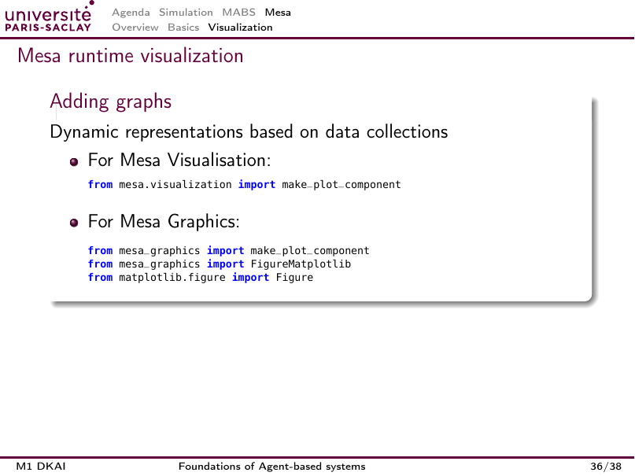

```text
Agenda Simulation MABS Mesa
Overview Basics Visualization
Mesa runtime visualization
Adding graphs
Dynamic representations based on data collections
For Mesa Visualisation:
frommesa.visualizationimportmake _plot_component
For Mesa Graphics:
frommesa _graphicsimportmake _plot_component
frommesa _graphicsimportFigureMatplotlib
frommatplotlib.figureimportFigure
Simple example: draw Gini coefficient in time
GiniPlot = make _plot_component("Gini")
page = SolaraViz/MesaGraphics( mm, renderer,
model_params=model_params,
name="Boltzmann Wealth Model",
components=[GiniPlot] # <- simply add the list of components
)
M1 DKAI Foundations of Agent-based systems 36/38
```

## Page 45

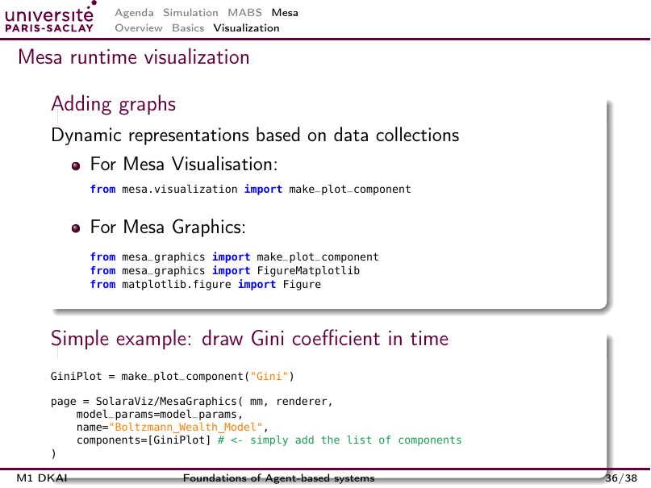

```text
Agenda Simulation MABS Mesa
Overview Basics Visualization
Mesa runtime visualization
Adding graphs
Dynamic representations based on data collections
For Mesa Visualisation:
frommesa.visualizationimportmake _plot_component
For Mesa Graphics:
frommesa _graphicsimportmake _plot_component
frommesa _graphicsimportFigureMatplotlib
frommatplotlib.figureimportFigure
Simple example: draw Gini coefficient in time
GiniPlot = make _plot_component("Gini")
page = SolaraViz/MesaGraphics( mm, renderer,
model_params=model_params,
name="Boltzmann Wealth Model",
components=[GiniPlot] # <- simply add the list of components
)
M1 DKAI Foundations of Agent-based systems 36/38
```

## Page 46

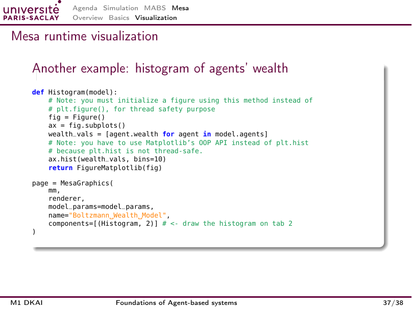

```text
Agenda Simulation MABS Mesa
Overview Basics Visualization
Mesa runtime visualization
Another example: histogram of agents’ wealth
defHistogram(model):
# Note: you must initialize a figure using this method instead of
# plt.figure(), for thread safety purpose
fig = Figure()
ax = fig.subplots()
wealth_vals = [agent.wealthforagentinmodel.agents]
# Note: you have to use Matplotlib’s OOP API instead of plt.hist
# because plt.hist is not thread-safe.
ax.hist(wealth_vals, bins=10)
returnFigureMatplotlib(fig)
page = MesaGraphics(
mm,
renderer,
model_params=model_params,
name="Boltzmann Wealth Model",
components=[(Histogram, 2)] # <- draw the histogram on tab 2
)
M1 DKAI Foundations of Agent-based systems 37/38
```

## Page 47

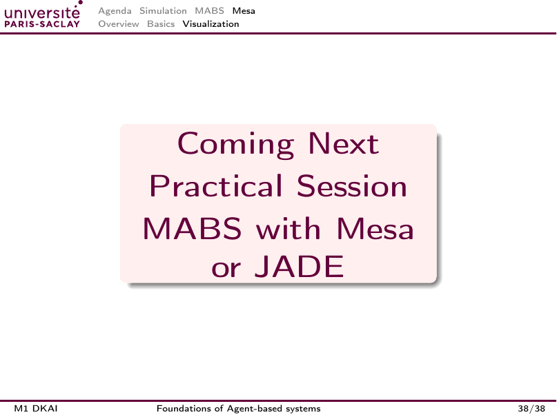

```text
Agenda Simulation MABS Mesa
Overview Basics Visualization
Coming Next
Practical Session
MABS with Mesa
or JADE
M1 DKAI Foundations of Agent-based systems 38/38
```
